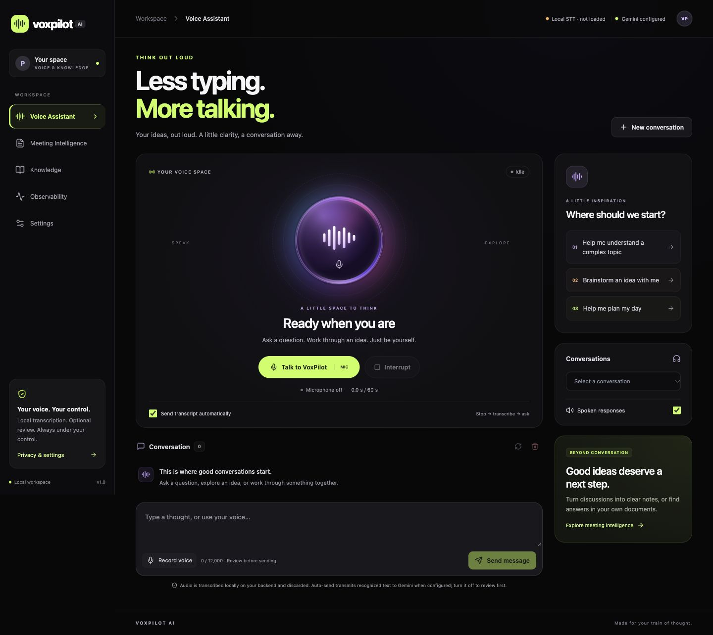

# VoxPilot AI

**Voice-First Knowledge Intelligence Platform**

A local-first, turn-based voice workspace built with React/TypeScript, FastAPI, LangChain, LangGraph, Gemini and PostgreSQL. Transcribe microphone audio locally, optionally review before auto-send, continue persistent conversations, generate editable meeting notes, ask grounded questions about PDFs/TXT files, and inspect actual request metrics.



## Latest updates

- **Voice Space interface:** near-black surfaces, electric-lime controls, a violet/pink voice orb, conversation bubbles and responsive navigation.
- **More reliable voice turns:** transcript delivery and answer playback no longer wait on status/history refreshes; saved answers remain visible if refresh fails.
- **Safer failures:** categorized Gemini errors, cancellation before generation, explicit browser-origin write checks and atomic rejection of invalid embeddings or blank grounded answers.
- **Repeatable verification:** 79 backend tests and 27 frontend tests passed locally, plus builds, lint, real local transcription and PostgreSQL smoke checks. Paid Gemini evaluation stays opt-in.
- **Developer handoff:** CI checks, architecture diagrams, a threat model, demo fixtures and an implementation-based interview guide. See [verification](docs/verification.md) for evidence and limitations.

## Run with Docker

Requires Docker Engine/Desktop with Compose v2 and an internet connection for the first build and Gemini calls.

```sh
test -e .env || cp .env.example .env
# Edit .env and set GEMINI_API_KEY to your Google AI Studio API key.
# Replace CHANGE_ME in both POSTGRES_PASSWORD and DATABASE_URL.
docker compose up --build -d
docker compose ps
```

A local `.env` with an empty key may already exist from verification. If so, edit it directly; do not overwrite your own configured file. Get a key from [Google AI Studio](https://aistudio.google.com/apikey). The key is server-side only: never add it to a `VITE_` variable. Restart configuration changes with `docker compose up -d --force-recreate backend`.

- App: [localhost:5173](http://localhost:5173)
- API health: [localhost:8000/api/v1/health](http://localhost:8000/api/v1/health)
- Swagger: [localhost:8000/docs](http://localhost:8000/docs)
- OpenAPI: [localhost:8000/openapi.json](http://localhost:8000/openapi.json)

The UI starts without a key. Sending messages, embedding documents and generating notes require a key. Config status checks key presence only; it does **not** claim the key, quota or configured model has been verified remotely.

Ports are bound to `127.0.0.1`. Change `FRONTEND_PORT`/`BACKEND_PORT` in `.env` if needed. If changing the frontend port, update `CORS_ORIGINS` too. Inside Docker, the database hostname is `db`; nginx proxies `/api/` to `backend:8000`. The browser never calls Gemini directly. Alembic runs before API startup, PostgreSQL has a persistent named volume, and all three services have health checks. Frontend and backend containers run without root privileges. Default memory limits total roughly 2.6 GB (allocate at least 4 GB to Docker); allow extra space for image builds.

```sh
docker compose logs --tail=100 backend
docker compose down                  # stops services; retains database volume
```

For a deliberate complete reset, `docker compose down -v` deletes the database permanently. To change the default local PostgreSQL password, update **both** `POSTGRES_PASSWORD` and the password in `DATABASE_URL` before first initialization; existing database credentials do not change when environment values change.

## Use the workspace

**Voice Assistant:** click the orb or Talk to VoxPilot, grant microphone permission, speak, then choose Stop & transcribe. MediaRecorder chooses a supported WebM/Opus, Ogg or MP4 format. A real Web Audio amplitude meter reacts to microphone input; when metering is unavailable the UI labels that limitation. The microphone is released on stop. The audio Blob goes to FastAPI and is decoded/transcribed locally by faster-whisper on CPU/int8. No external transcription API or Gemini key is required.

Automatic submission is **on by default**: after recognition, text goes through the existing LangGraph/Gemini workflow and the browser reads the answer. Turn off Send transcript automatically to review/edit first. Without a Gemini key, recognized text remains editable and the UI explains that only response generation needs a key. Text input always works. Ctrl/Cmd+Enter sends text. Play / Replay replays an answer; Interrupt cancels recording or playback immediately and aborts the current browser request. Browser cancellation does not guarantee remote Gemini cancellation.

Model weights (`base`, multilingual by default) download on first preparation/use. Prepare them from Settings → Prepare local model, or run:

```sh
curl -X POST http://localhost:8000/api/v1/audio/prepare
curl http://localhost:8000/api/v1/audio/status
# Test actual local recognition with the included public speech fixture; no Gemini key needed.
curl -F 'file=@backend/tests/fixtures/jfk.wav;type=audio/wav' http://localhost:8000/api/v1/audio/transcribe
```

First preparation can take several minutes on a slow connection. The API remains healthy during download, and status reports `not_loaded`, `loading`, `ready` or `error`. Retry preparation after correcting network/cache settings. The Docker `whisper_models` volume retains weights across recreations. Recordings are not kept in that volume. Subsequent recognition works offline once weights are cached. `STT_MODEL`, `STT_DEVICE`, `STT_COMPUTE_TYPE`, `STT_CPU_THREADS`, `STT_MAX_UPLOAD_BYTES`, `STT_MAX_DURATION_SECONDS` and `STT_MIN_DURATION_SECONDS` are configurable; Compose sets the cache directory to `/models`. The default maximum recording duration is 60 seconds and upload limit is 10 MB. For host-only development, omit `STT_MODEL_CACHE` or use a writable local path, not `/models`.

Use a current browser with MediaRecorder/getUserMedia (Chrome, Edge, Firefox or Safari), on localhost or HTTPS. A raw LAN HTTP address usually cannot access the microphone; use HTTPS if accessing from another device. Default ports are loopback-only, so remote-device access also requires a separately secured TLS reverse proxy, appropriate CORS and authenticated deployment controls. The app no longer uses SpeechRecognition/webkitSpeechRecognition or browser-vendor transcription. Browser synthesis voices still depend on your OS and may use vendor services. Microphone audio is uploaded only to this backend, decoded with PyAV, processed locally and discarded. Multipart handling may briefly spool large uploads to an OS temporary file, which is closed and removed. User recordings are not saved permanently. Voice selection/rate remain in Settings.

**Meeting Intelligence:** create a titled meeting, accumulate recognized transcript segments automatically (or review and use Add transcript with auto-send off), and choose Finish & generate notes after at least 20 words. Generating notes is one model call, not a call per microphone fragment. Edit the summary, lists and action items, update their status, save changes, delete notes, or export Markdown. Appending more transcript leaves existing notes unchanged until you regenerate. Meetings are separate sessions and can be reopened from the meeting list.

**Knowledge:** create/select a conversation, upload a UTF-8 TXT or text-based PDF, select it, and ask by voice or text. Upload finishes only after extraction and real Gemini embeddings succeed. Answers show validated chunk references, filenames, excerpts and PDF page numbers. No qualifying context yields an explicit missing-evidence answer. Changing the embedding model requires deleting and re-uploading existing documents. Raw upload bytes are discarded; extracted text and vectors persist until document/session deletion. Scanned PDFs need OCR, which is not included.

**Observability:** refresh to see actual workflow totals, error rate, latency, SDK-reported tokens and traces. Missing usage stays unavailable. P95 uses up to 1,000 recent workflow latencies; the chart/table show the newest 50. Metrics include local transcription and generation requests. They exclude document uploads, HTTP validation failures, and read requests. The local speech diagnostics show real in-process success/failure counts, readiness, and latency; these counters reset on backend restart. No payload text is stored in traces.

## Architecture

```text
voxpilot-ai/
├── frontend/
│   ├── src/
│   │   ├── components/       # reviewed transcript composer
│   │   ├── features/         # chat, meetings, documents, observability, settings
│   │   ├── services/         # fetch/cancellation, speech provider interfaces
│   │   ├── App.tsx           # workspace state and navigation
│   │   └── styles.css
│   ├── Dockerfile
│   ├── nginx.conf
│   └── package.json / package-lock.json
├── backend/
│   ├── app/
│   │   ├── api/              # versioned REST routes
│   │   ├── core/             # environment settings and errors
│   │   ├── db/               # SQLAlchemy models and database factory
│   │   ├── repositories/     # session lookup and bounded history
│   │   ├── schemas/          # Pydantic API and structured model output
│   │   ├── providers/        # supported Gemini chat/embedding integration
│   │   ├── graph/            # typed LangGraph workflow
│   │   ├── services/         # extraction, chunking and retrieval
│   │   └── observability/    # reusable payload-free traces
│   ├── alembic/              # explicit upgrade/downgrade migration
│   ├── tests/                # deterministic tests and opt-in live probes
│   ├── evals/cases.json
│   └── requirements.txt      # exact resolved dependencies, including test tools
├── scripts/smoke.py
├── docs/                     # architecture, security, verification
├── .env.example
└── docker-compose.yml
```

**LangChain** builds `ChatPromptTemplate` → `ChatGoogleGenerativeAI` runnable pipelines, injects recent history, validates structured meeting/grounded output with Pydantic, and uses `GoogleGenerativeAIEmbeddings` for document/query vectors. **LangGraph** executes a typed, bounded six-node path: validate input → load context → classify explicit UI intent → dedicated chat/meeting/document node → validate output → persist successful result. Routing adds no classification model call, retries are disabled to bound quota usage, and failed generations do not persist successful conversation turns. See [architecture](docs/architecture.md) for node purposes and retrieval tradeoffs.

The default generation model is `gemini-3.6-flash`, verified in the official [model catalog](https://ai.google.dev/gemini-api/docs/models). Embeddings remain `gemini-embedding-001`; changing embedding models requires re-uploading documents. Both identifiers are explicitly configurable with no silent fallback. The [LangChain integration](https://docs.langchain.com/oss/python/integrations/chat/google_generative_ai) uses the Google GenAI SDK. Account access and quota require a real request; deterministic tests do not establish them.

## Development without Docker

Use Python 3.11 and Node 22.12+ (or a compatible newer Node). From the project root:

```sh
python3.11 -m venv .venv
.venv/bin/pip install -r backend/requirements.txt
cd backend
export DATABASE_URL=sqlite:///./voxpilot.db
# Set GEMINI_API_KEY and optional GEMINI_MODEL in this terminal.
../.venv/bin/alembic upgrade head
../.venv/bin/uvicorn app.main:app --reload --host 127.0.0.1 --port 8000 --no-access-log
```

In another terminal:

```sh
cd frontend
npm ci
npm run dev
```

Vite proxies `/api` to `127.0.0.1:8000`. Backend settings load environment variables and `.env` from the **backend process working directory**; the root `.env` is passed automatically only by Compose. For host development, export the key or create a private `backend/.env` with a SQLite URL; never reuse the Docker `db` hostname on the host. Apply migrations whenever the schema changes. Do not call `create_all` in production; tests use it only for disposable fixtures.

## Tests and evaluation

```sh
cd backend
../.venv/bin/python -m pytest       # mocks only; live test skipped
cd ../frontend
npm test
npm run build                     # TypeScript check + production bundle
cd ..
.venv/bin/ruff check backend
python3 scripts/smoke.py           # running Compose stack; no paid calls
```

The smoke script creates and removes its own disposable sessions. It checks real PostgreSQL persistence and the nginx proxy, and exercises the missing-key error path when appropriate. The backend suite also runs inside the image: `docker compose exec backend python -m pytest -o cache_dir=/tmp/pytest-cache`.

Paid integration/semantic probes are opt-in. From `backend/`, supply the server key through your environment, then:

```sh
RUN_LIVE_GEMINI=1 ../.venv/bin/python -m pytest -m live -v
```

This makes four generation calls and may incur costs. The live suite checks context recall, missing evidence, one document injection probe and missing meeting ownership with transparent substring/structured-field checks. It is a small regression set, not a measure of general accuracy or proof against prompt injection. Default tests mock model inference but exercise the real audio decoder with WAV/WebM fixtures. A real CPU/int8 recognition probe is available with `python scripts/transcription_smoke.py` against a running backend. Default tests verify prompt boundaries, schema/citation checks and deterministic failure paths with mocks. See [verification](docs/verification.md) for observed results and the manual browser checklist.

## Security, privacy and limits

This is a **single-user local MVP**, not a public multi-user service. There is no authentication: anyone with API access can list sessions, read data and view operational metadata. Session UUIDs scope retrieval but do not provide access control. Add identity-based ownership checks across every route, protected metrics, TLS, distributed abuse controls and a security review before public deployment. CORS is not authentication.

The API bounds inputs and uploads, validates IDs, limits mutating requests in one process, sanitizes error responses, and does not log prompts, uploaded text, responses or API keys. No model-generated code or commands are executed. Retrieved text is untrusted data in a system-constrained prompt; citation IDs and action evidence are verified, but semantic grounding is still probabilistic. Manual meeting edits are accepted as user-authored content.

Session TTL disables further use after the configured duration; it **does not automatically erase stored content**. Delete sessions/meetings to remove content and cascade document chunks. Trace retention filters old records immediately and purges them on the next workflow completion. Deleting a session leaves payload-free hashed operational traces until retention expires. Database volumes/backups are not encrypted or securely erased by the application. See [security notes](docs/security.md).

Stopping playback cancels browser synthesis. AbortController cancels the browser HTTP request; it does **not** guarantee remote Gemini cancellation. The SDK coroutine is bounded by a timeout, but remote billing/completion can still occur after timeout/disconnect, and the server may save a result. Refresh before retrying. This implementation is turn-based, with no full-duplex audio, live audio streaming, or incremental text streaming.

## Troubleshooting and next steps

- **Provider unconfigured:** edit the root `.env`, then recreate the backend container. Check `/api/v1/config/status`; it reveals no key.
- **Provider error / invalid key / unavailable model:** check your Google AI Studio key, Developer API access, configured model ID and network. The app will never substitute a different model.
- **Quota exhausted:** wait for quota reset or adjust the provider account quota/billing. Automatic retries are deliberately disabled.
- **Timeout:** refresh the conversation before retrying to avoid another generation after an HTTP cancellation. Increase `REQUEST_TIMEOUT_SECONDS` if appropriate; document operations may require multiple calls.
- **Microphone denied/unavailable:** enable permission in site settings, check the OS microphone input, use HTTPS/localhost, or type. If recording works but transcription fails, inspect `/api/v1/audio/status` and model preparation; then check network access to Hugging Face, cache permissions and supported MIME formats.
- **Short meeting / context limit:** add at least 20 words. The default total meeting transcript cap is 12,000 characters. Split long meetings into sessions or deliberately raise the limit; no silent truncation is performed.
- **Empty PDF:** upload searchable text; OCR and encrypted PDFs are not supported.
- **Model output rejected:** a schema, evidence quote or citation failed validation. Retry, review the transcript, or reduce the material. No fabricated success is shown.
- **Session busy:** one session request is already running. Wait, refresh and retry. This guard/rate limiter assumes a single API worker.
- **Database unhealthy:** check `docker compose ps` and migration/service logs. The database is not exposed on a host port.

Useful next improvements: authenticated user ownership and managed secrets; longer-meeting chunked summarization with evidence spans; a benchmarked retrieval corpus and calibrated thresholds; pgvector indexing for larger collections; durable idempotency for cancelled/retried turns; and a true streaming speech provider behind the existing interfaces.

## Voice repair and cosmic redesign

The original microphone flow only checked permission, stopped that stream and delegated recognition to browser SpeechRecognition. There was no MediaRecorder upload, audio decoder, transcription endpoint or local model, so browser/vendor failures had no backend fallback. See [repair details](docs/voice-repair.md) for the changed files, state machine, privacy changes and real verification results. The existing Gemini, LangChain, LangGraph, meeting, retrieval and persistence integrations were preserved.

## Gemini 3.6 configuration

The current `.env.example` selects `gemini-3.6-flash`, MAX_OUTPUT_TOKENS=4096 and REQUEST_TIMEOUT_SECONDS=90. Gemini 3+ requests omit custom sampling parameters and candidate_count; the pinned integration's final SDK request configuration is covered by chat and structured-output regression tests. Legacy Gemini 2.5 configurations retain their configured temperature. Google migration reference: https://ai.google.dev/gemini-api/docs/generate-content/whats-new-gemini-3.6

run `docker compose up --build -d backend`; a plain container restart does not reload changed Compose environment values. Use a newly rotated private server API key. The model identifier is verified in documentation, but account access, key validity and quota still require an actual request.


## Engineering evidence and interview preparation

For students reviewing course material, teams preparing meeting notes and knowledge workers searching their own documents, the complete implemented flows are voice/text chat, transcript-to-editable-notes, and selected-document Q&A. This remains a personal local workspace.

- [Implementation checklist and remaining work](docs/implementation-checklist.md)
- [Architecture and sequence diagrams](docs/architecture.md)
- [Research and decisions](docs/research-and-decisions.md) / [decision records](docs/architecture-decisions.md)
- [Evaluation methodology and measurements](docs/evaluation.md) / [executed verification](docs/verification.md)
- [Threat model](docs/threat-model.md) / [operations and recovery](docs/operations.md)
- [Interview defence guide](docs/interview-guide.md) / [five-minute demo and sample data](docs/demo-script.md)

The API rejects browser writes from origins outside `CORS_ORIGINS`; list exact frontend origins when changing ports. This supplements CORS and does not add authentication. Source references currently survive only in the current document-answer view, not in persisted message history.

For reference-based offline speech evaluation after caching weights, run `HF_HUB_OFFLINE=1 .venv/bin/python scripts/evaluate_stt.py`. CI is defined in `.github/workflows/verify.yml` and runs on pushes and pull requests; check the repository Actions tab for hosted results. No new runtime dependencies were added in this increment.
