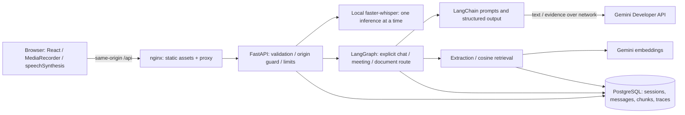

# Design notes

## Workflow

Each request builds a compiled LangGraph around its own SQLAlchemy transaction, Gemini provider and trace. A typed state carries the input, explicit intent, bounded history, answer and structured artifacts. Six nodes execute on each successful path; recursion is limited to 12 steps. There is no agent loop and no autonomous tool execution.

| Node | Purpose |
| --- | --- |
| validate_input | Reject blank and oversized input using central configuration. |
| load_context | Verify session existence, kind and expiry; load recent history for chat within count and character budgets. |
| classify_intent | Route the explicit API/UI intent deterministically, without another model call. |
| conversational_response | Compose the system prompt, session history and current message using LangChain, then asynchronously call Gemini. |
| meeting_notes_workflow | Require a meaningful transcript and produce a validated MeetingNotes schema in one call. |
| document_question_answering | Embed the question, retrieve authorized document chunks, and ask Gemini for a schema-constrained cited answer. Skip generation when no evidence qualifies. |
| validate_output | Reject empty chat output, invalid citation IDs and action items whose exact evidence/owner/deadline do not match the transcript. |
| persist_result | Recheck expiry and save successful messages or notes transactionally. |

Only one of the three generation nodes runs. The request service rolls back failures and writes a separate payload-free trace regardless of outcome. Model exceptions are mapped to safe configuration, quota, timeout, invalid-output or provider-error categories. Model time includes structured parsing; workflow time includes graph and persistence. Input/output tokens are exact SDK usage when supplied, never estimates. A trace write failure is logged by correlation ID; it does not turn a persisted answer into a failed answer.

## Persistence and scope

PostgreSQL 16 is the Compose default. SQLite supports local development and isolated tests. SQLAlchemy models and explicit Alembic migrations define sessions (kind chat/meeting), messages, document metadata, chunks/vectors and traces. Foreign keys cascade session deletion to messages/documents and document deletion to chunks. UUIDs are validated by FastAPI. Sessions expire at creation time plus TTL; expiry blocks reads/workflows but rows can still be deleted. List endpoints paginate and expose expired session metadata for local management.

This is a local single-user security scope. Every document operation requires the parent session ID, and retrieval joins the selected document to that session. UUID scoping prevents accidental cross-session retrieval, not malicious access by someone with API access. Multi-user operation requires authenticated ownership on all models and queries.

A per-session in-memory guard prevents concurrent generation, transcript edits or deletion from racing in one worker. A bounded one-minute per-client limiter covers mutations. Neither is a distributed lock/rate limit. Use one backend worker as configured. There is no durable idempotency key; an interrupted browser request can complete remotely and be saved. Refresh before retrying.

## Retrieval

Files are read with a byte bound, parsed in a worker thread, and discarded. TXT must be UTF-8 without NUL characters. PDFs require a PDF signature, no encryption, at most 100 pages and readable extracted text. Extraction is capped at 100,000 characters by default; no OCR or original-file storage is provided. Chunking is page-aware with configurable 1,000-character chunks and 150-character overlap, so PDF page provenance is retained. At most 20 documents are allowed per session.

The explicitly configured `gemini-embedding-001` integration embeds documents with RETRIEVAL_DOCUMENT and queries with RETRIEVAL_QUERY. Embeddings are stored as JSON arrays in the relational database. Cosine retrieval scans only the selected session-authorized document's chunks, then takes the best four above a configurable 0.3 similarity threshold. This is real vector retrieval optimized for small local corpora, with no vector database service. The threshold is a heuristic, not a calibrated relevance probability. Changing the model or dimensions produces an explicit re-upload requirement rather than comparing incompatible spaces.

The RAG chain receives the current question and retrieved evidence as serialized untrusted data, under a system prompt that prohibits obeying document instructions or filling gaps from outside knowledge. Its structured answer names chunk IDs. Unknown IDs cause failure. No citations or insufficient evidence results in a consistent missing-evidence message. Valid references return filenames, page numbers where available, and actual excerpts. Citation membership does not prove semantic support; this requires evaluation/human review.

## Voice and frontend

RecordingProvider and SynthesisProvider isolate capture and browser playback. BrowserRecorder keeps getUserMedia tracks live during MediaRecorder capture, selects a supported MIME format and produces a binary Blob. It releases microphone tracks on stop/cancel/permission races and uses a Web Audio AnalyserNode RMS amplitude to drive the orb. Unsupported amplitude measurement is labeled, not faked. Recording is capped by time and byte count; transcript submission can be automatic (default) or reviewed first.

`POST /audio/transcribe` bounds multipart bytes, closes temporary upload handles, validates MIME against the decoded container, resamples to mono 16 kHz float32 with a sample-count duration bound, and runs local inference in a worker thread. A reusable, lock-protected faster-whisper base model uses CPU/int8. VAD avoids many silence-only hallucinations. Empty recognition is an explicit error. No Gemini call is involved in transcription. The status/preparation endpoints expose safe readiness and failure categories. Model initialization happens off the event loop, with persistent Docker weights at /models. Only one inference runs at a time; excess requests get 429. Corrupt/oversized audio does not trigger a model download.

The frontend voice state machine separates idle, requesting_permission, listening, stopping_recording, transcribing, transcript_ready, thinking, speaking and error. Invalid transitions and overlapping recording are blocked; epoch checks discard cancelled/stale transcription replies. Auto-send passes recognized text directly into the existing session-scoped chat/meeting/document route, without relying on asynchronous draft state updates. Missing Gemini configuration leaves text available. Per-turn measured recording duration, transcription latency, Gemini latency and total elapsed turn time are shown when available, never estimated. Transcription traces retain metadata only; in-process counters reset on restart.

Browser speech synthesis remains client-side. Interrupt detaches expected cancellation handlers, cancels capture/fetch and calls speechSynthesis.cancel. Text is preserved if playback fails. API fetch is bounded by AbortController timeouts, but closing a client connection cannot stop an already-running native inference thread or guarantee Gemini cancellation. Turns are not full duplex or streaming. Raw recordings are discarded after local processing; larger multipart uploads may be briefly spooled by Starlette and are closed reliably.

The Voice Space theme uses a near-black canvas, charcoal surfaces, electric-lime actions and a violet/pink CSS voice orb. The keyboard-operable orb and recording controls retain the existing speech lifecycle. Listening bars and expansion use measured microphone amplitude; the idle symbol and speaking/processing effects are decorative state indicators, not synthesized microphone data. Reduced-motion disables animations and dynamic scaling. Chat, meetings, documents, settings and observability retain their original operations.

## Deployment decisions

A non-root Python container runs migrations then a single Uvicorn process. A multi-stage Node build produces static React assets, served by an unprivileged nginx container. Browser API requests use a same-origin nginx proxy; no API secret enters the build. PostgreSQL readiness gates backend startup, and backend readiness gates frontend startup. Secrets remain environment configuration, excluded by .gitignore/.dockerignore. Dependency versions are exact in requirements.txt and package-lock.json. Docker base images use maintained version tags; production deployments should pin reviewed image digests and add image scanning/backups.

## Component and deployment views



Compose places nginx, FastAPI and PostgreSQL in separate containers on a private network. Only frontend/API ports bind to host loopback. PostgreSQL and Whisper caches use named volumes. Host development can use SQLite instead. These are deployment units, not independent microservices.

```mermaid
sequenceDiagram
  actor User
  participant UI as React + MediaRecorder
  participant API as FastAPI
  participant STT as faster-whisper
  participant Graph as LangGraph
  participant Model as Gemini
  participant DB as PostgreSQL
  User->>UI: Record, then stop
  UI->>API: Bounded audio upload
  API->>STT: Decode and transcribe in worker thread
  STT-->>UI: Final transcript via API
  Note over UI: Edit first or auto-send; status refresh is advisory
  UI->>API: Text + session + explicit operation
  API->>Graph: Validate request and load bounded context
  Graph->>Model: Prompt + history or retrieved evidence
  Model-->>Graph: Text or structured output + usage
  Graph->>Graph: Validate output and references
  alt Valid result
    Graph->>DB: Commit successful message pair / notes
    Graph-->>UI: Answer via API
    UI->>User: Browser speech synthesis
    UI->>API: Refresh stored history
  else Provider or validation failure
    Graph-->>API: Safe categorized error; rollback
    API-->>UI: Recovery message; keep draft
  end
  API->>DB: Separate payload-free trace
```

## Concepts and boundaries

- **LangChain vs LangGraph:** LangChain adapts prompts, messages and Gemini schemas; LangGraph orders application steps. Explicit routing is a workflow, not an autonomous agent.
- **Recognition vs generation:** local faster-whisper predicts spoken text from audio; remotely hosted Gemini generates answers/notes from text. Browser synthesis turns answer text into speech and may depend on OS/browser voice implementation.
- **Application storage vs checkpoints:** SQLAlchemy stores completed business records. No LangGraph checkpointer is configured; interrupted graph runs cannot resume from a saved node.
- **Embeddings vs answers:** embeddings are numeric retrieval features, stored with model identity; answers are generated language. Numeric validity and dimension checks cannot establish relevance.
- **Retrieval vs reranking:** cosine retrieval selects passages once. There is no second learned reranker, hybrid search or calibrated relevance score.
- **Structured output vs factual validation:** Pydantic checks shape; graph checks citation membership and exact action evidence. Neither proves that every sentence follows from evidence.

## 25 October reliability changes

Status polling no longer blocks transcript delivery, and message history refresh no longer gates answer playback. Failed history refresh explicitly says the answer was saved. Cancellation during session initialization prevents starting a later generation. Native inference and remote generation remain non-preemptible from the browser's perspective.

`services/retrieval.py` validates count, numeric finiteness, nonzero norm and consistent dimensions before storing embeddings; queries and stored vectors are checked before cosine ranking. Model/dimension mismatch remains an explicit re-upload error. Cosine uses normalized factors to avoid overflow for large finite vectors. A malformed embedding is an operational failure, not evidence that a question is unanswerable. Grounded whitespace-only answers are rejected before persistence.

`main.py` rejects mutation requests with an Origin outside `CORS_ORIGINS`, including opaque `null` origins; explicit cross-site Fetch Metadata without Origin is also rejected. Originless CLI requests remain supported. This mitigates browser-triggered writes, not local attackers, DNS rebinding or unauthenticated API access. Do not expose this local edition publicly.

Known persistence limitation: document answer text is stored as conversation messages, but source excerpts/IDs are only returned in the current response, not saved with the message. Reloading the page loses the citation panel. Add a versioned source snapshot migration before claiming durable source provenance.
